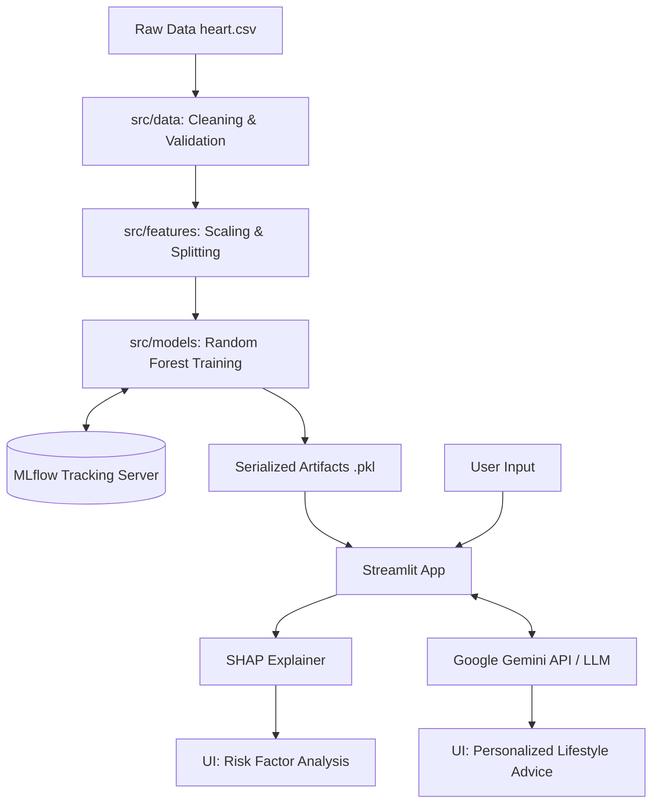

# Heart Disease Prediction System

🔗 **Access the live app here:** [Prediksi Penyakit Jantung](https://arfi-heartdiseasepredict.streamlit.app/)


## 📌 Deskripsi Proyek
Sistem Machine Learning end-to-end untuk memprediksi kemungkinan penyakit jantung berdasarkan data rekam medis pasien. Proyek ini tidak hanya menerapkan model Random Forest, tetapi juga mengimplementasikan praktik terbaik di industri data science modern (2026):

- **Modular Code & OOP**: Memisahkan pipeline ETL, feature engineering, dan model training di dalam `src/`.
- **MLOps & Experiment Tracking**: Menggunakan **MLflow** untuk tracking hyperparameter, versi model, dan metrik evaluasi.
- **Explainable AI (XAI)**: Mengintegrasikan **SHAP (SHapley Additive exPlanations)** agar prediksi model transparan dan dapat dimengerti (bukan *black-box*).
- **Generative AI Integration**: Menggunakan **Google Gemini API** untuk memberikan rekomendasi gaya hidup otomatis yang dipersonalisasi berdasarkan input pasien.
- **CI/CD & Docker**: Otomatisasi testing dengan GitHub Actions dan deployment-ready menggunakan Docker.

## 🏗️ Arsitektur Sistem



## 🚀 Cara Menjalankan Secara Lokal

### 1. Menggunakan Python Virtual Environment
```bash
# Install dependencies
pip install -r requirements.txt

# Setup API Key (PENTING)
# Ubah nilai di dalam file .env dengan API Key Google Gemini Anda
# GEMINI_API_KEY=AIzaSy...

# Jalankan aplikasi Streamlit
streamlit run app.py
```

### 2. Menggunakan Docker
```bash
# Build image
docker build -t heart-disease-app .

# Run container
docker run -p 8501:8501 --env-file .env heart-disease-app
```
Akses aplikasi melalui browser di `http://localhost:8501`.

## 🧪 Testing dan Pipeline Training
Untuk menjalankan ulang proses *training* dan merekam eksperimen ke MLflow:
```bash
export PYTHONPATH="."
python -m src.models.train_model
```
Untuk menjalankan *unit tests*:
```bash
export PYTHONPATH="."
pytest tests/
```

## 👤 Tentang Penulis
**Arfi Adi Nugroho**
- LinkedIn: [Arfi Adi Nugroho](https://www.linkedin.com/in/arfi-adi-nugroho-58b0a7263)
- GitHub: [Arfiadi](https://github.com/Arfiadi)
