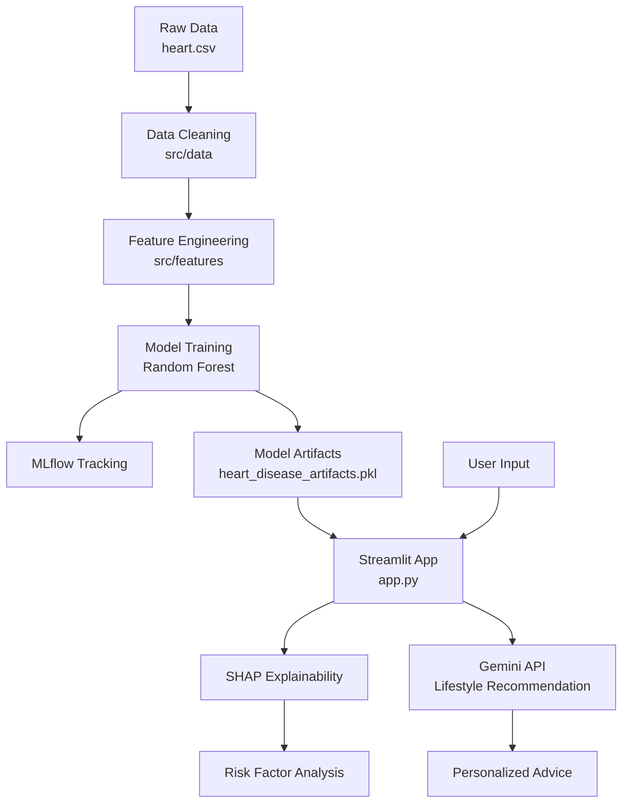

# Heart Disease Prediction System

[](https://www.python.org/downloads/release/python-3100/)
[](https://streamlit.io/)
[](https://mlflow.org/)
[](LICENSE)

🔗 **Live Demo:** [Prediksi Penyakit Jantung](https://arfi-heartdiseasepredict.streamlit.app/)

## 📌 Project Overview

This project builds an end-to-end machine learning system to predict heart disease risk based on patient medical data. The system combines data preprocessing, feature selection, model training, SHAP-based explainability, and an AI-powered lifestyle recommendation feature.

### Key Features
- 🔄 **Modular ML pipeline**: data processing, feature engineering, and model training are separated into modules
- 📊 **Model comparison and evaluation**: multiple classifiers were compared using cross-validation and ROC-AUC
- 🔍 **Explainable AI**: SHAP used to explain model predictions
- 🤖 **Generative AI integration**: Google Gemini API provides personalized lifestyle suggestions
- 🌐 **Interactive web app**: Streamlit-based dashboard for predictions
- 🐳 **Docker support**: easy local deployment and reproducibility
- 📈 **MLflow tracking**: experiment logging and model tracking

---

## 📊 Dataset and Model Performance

| Item | Detail |
|------|--------|
| **Raw dataset** | 1025 samples |
| **Cleaned dataset** | 283 samples |
| **Selected features** | 9 clinical attributes |
| **Target variable** | Heart disease presence (0/1) |
| **Train-test split** | 80:20 |
| **Final model** | Random Forest |
| **Accuracy** | 84% |
| **AUC-ROC** | 0.91 |
| **Precision (Class 1)** | 0.82 |
| **Recall (Class 1)** | 0.90 |

### Selected Features
- `age`
- `sex`
- `cp` (chest pain type)
- `thalach` (maximum heart rate)
- `slope`
- `oldpeak`
- `exang`
- `ca`
- `thal`

---

## 🏗️ System Architecture



---

## 🚀 Quick Start

### Prerequisites
- Python 3.10+
- pip or conda
- Google Gemini API Key (optional for lifestyle recommendation feature)

### 1. Clone Repository
```bash
git clone https://github.com/Arfiadi/heart-disease-prediction.git
cd heart-disease-prediction
```

### 2. Create Virtual Environment
```bash
python -m venv venv
source venv/bin/activate
# Windows:
# venv\Scripts\activate
```

### 3. Install Dependencies
```bash
pip install -r requirements.txt
```

### 4. Setup API Key (Optional)
Create a `.env` file in the project root:
```bash
GEMINI_API_KEY=your_api_key_here
```

### 5. Run Application
```bash
streamlit run app.py
```

Then open:
```bash
http://localhost:8501
```

---

## 🐳 Docker Deployment

```bash
# Build image
docker build -t heart-disease-app .

# Run container
docker run -p 8501:8501 --env-file .env heart-disease-app
```

---

## 📁 Project Structure

```text
heart-disease-prediction/
├── app.py                          # Streamlit application
├── requirements.txt                # Project dependencies
├── Dockerfile                      # Container configuration
├── heart.csv                      # Dataset
├── heart_disease_artifacts.pkl     # Trained model + scaler
├── .gitignore
├── README.md
│
├── src/
│   ├── data/
│   │   └── make_dataset.py        # Data loading and cleaning
│   ├── features/
│   │   └── build_features.py      # Feature scaling and train-test split
│   ├── models/
│   │   └── train_model.py         # Training pipeline and MLflow logging
│   └── services/
│       └── llm_advisor.py         # Gemini API integration
│
├── notebooks/
│   ├── Cleaning, Preprocessing and EDA.ipynb
│   └── modelling_hd.ipynb
│
├── tests/
│   └── (unit tests)
│
└── .github/
    └── workflows/
```

---

## 🧪 Model Development and Training

### Train the Model
```bash
export PYTHONPATH="."
python -m src.models.train_model
```

This script will:
- load the dataset
- clean the data
- select the important features
- split into train/test sets
- scale the features
- train the Random Forest model
- log metrics to MLflow
- save model artifacts to `heart_disease_artifacts.pkl`

---

## 🔍 Model Comparison Summary

From the notebook `notebooks/modelling_hd.ipynb`, the following models were compared:

| Model | Accuracy | AUC-ROC | Notes |
|-------|----------|---------|-------|
| Logistic Regression | 84% | 0.88 | Stable baseline |
| Decision Tree | 72% | 0.84 | Lower performance |
| Random Forest | 82% | 0.91 | Best AUC among tested tree-based model |
| MLP | 86% | 0.89 | Competitive but less preferred for explainability |

### Why Random Forest was selected
- ✅ Strong ROC-AUC performance
- ✅ Good balance between performance and interpretability
- ✅ Compatible with SHAP for explainable predictions
- ✅ Suitable for deployment in Streamlit

---

## 💡 Features in the Web App

### 1. Prediction
User inputs clinical data, and the model predicts whether the patient has a risk of heart disease.

### 2. Explainable AI (SHAP)
The app visualizes the important features that contribute to the prediction.

### 3. Personalized Recommendations
Using the Google Gemini API, the app provides health and lifestyle suggestions based on the patient profile.

---

## 📚 Tech Stack

| Layer | Tools |
|------|-------|
| Data processing | Pandas, NumPy |
| Modeling | Scikit-learn, Random Forest |
| Explainability | SHAP |
| App interface | Streamlit |
| Model tracking | MLflow |
| AI recommendation | Google Generative AI / Gemini |
| Deployment | Docker |
| Version control | Git, GitHub |

---

## ⚠️ Disclaimer

This project is intended for educational and research purposes only. It is not a substitute for professional medical diagnosis or treatment. Always consult a licensed healthcare professional for medical advice.

---

## 👤 Author

**Arfi Adi Nugroho**

- LinkedIn: [Arfi Adi Nugroho](https://www.linkedin.com/in/arfi-adi-nugroho-58b0a7263)
- GitHub: [@Arfiadi](https://github.com/Arfiadi)

---

## 🙏 Acknowledgments

- Dataset from the [UCI Machine Learning Repository](https://archive.ics.uci.edu/dataset/45/heart+disease)
- Libraries used: Scikit-learn, SHAP, Streamlit, MLflow, Google Generative AI
