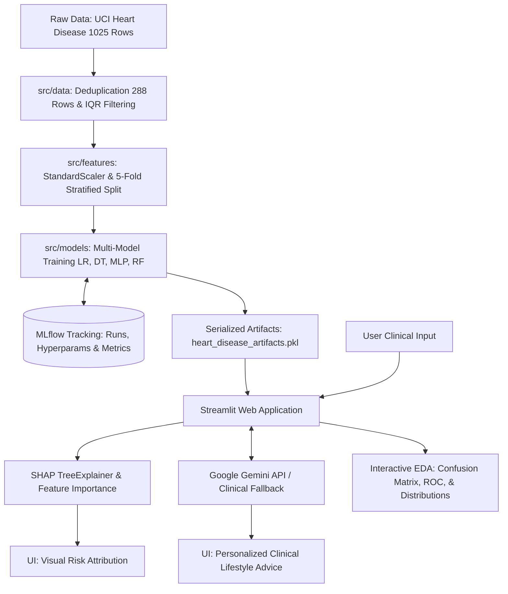

# 🫀 Heart Disease Clinical Screening & Prediction System

[](https://github.com/Arfiadi/heart-disease-prediction/actions/workflows/ci.yml)
[](https://www.python.org/)
[](https://arfi-heartdiseasepredict.streamlit.app/)
[](https://scikit-learn.org/)
[](https://mlflow.org/)
[](https://www.docker.com/)

🔗 **Live Interactive Web Application:** [arfi-heartdiseasepredict.streamlit.app](https://arfi-heartdiseasepredict.streamlit.app/)

---

## 📌 Project Overview & Clinical Context

Cardiovascular disease is the leading cause of mortality worldwide. This project builds an end-to-end **Clinical Decision Support System (CDSS)** to screen and estimate heart disease risk from routine diagnostic measurements.

### Key System Highlights
- 🔄 **End-to-End Scikit-Learn Pipeline**: Enkapsulasi atomik `StandardScaler` dan *estimator* (`sklearn.pipeline.Pipeline`) yang secara ketat mencegah *data leakage* pada 5-Fold Stratified Cross-Validation dan produksi.
- 📊 **Rigor & 5-Fold Stratified Cross-Validation**: Validasi silang bebas kebocoran data untuk menjamin kestabilan generalisasi pada unseen data.
- 🏆 **Multi-Model Comparison**: Evaluates 4 distinct algorithmic paradigms (Linear, Decision Tree, Neural Network / MLP, and Tuned Random Forest) tracked with **MLflow**.
- 🔍 **Explainable AI (XAI)**: Demystifies black-box predictions using **SHAP (SHapley Additive exPlanations)** and Gini Feature Importance.
- 🤖 **AI Lifestyle Advisor with Graceful Fallback**: Personalized lifestyle recommendations powered by the **Google Gemini API**, with an automatic clinical rule-based fallback when offline.
- 🌐 **Interactive Streamlit App**: Live multi-page dashboard featuring interactive EDA, confusion matrix heatmaps, and ROC curves.
- 🧪 **Comprehensive Testing (CI/CD)**: 14 automated unit tests with quality thresholds (`Accuracy >= 0.75`, `ROC-AUC >= 0.80`), Pipeline integrity checks, Ruff linting, and Docker container build validation.

---

## 🏆 Model Evaluation & Comparison Summary

All models were evaluated on an independent 20% holdout test set and cross-validated with **5-Fold Stratified Cross-Validation** on the training data:

| Model | Category | Test Accuracy | Precision | Recall (Sensitivity) | F1-Score | AUC-ROC | 5-Fold CV Accuracy |
|---|---|:---:|:---:|:---:|:---:|:---:|:---:|
| Logistic Regression | Linear Model | 81.0% | 0.829 | 0.853 | 0.841 | 0.854 | 82.2% (±5.4%) |
| Decision Tree | Tree-Based | 79.3% | 0.844 | 0.794 | 0.818 | 0.879 | 77.4% (±7.1%) |
| **MLP Neural Network** | **Deep Learning / NN** | **82.8%** | **0.853** | **0.853** | **0.853** | **0.864** | **82.2% (±7.2%)** |
| **Random Forest (Tuned)** | **Ensemble Learning** | **82.8%** | **0.875** | **0.824** | **0.849** | **0.898** | **83.0% (±5.4%)** |

> [!NOTE]
> **Clinical Model Selection Rationale (Random Forest vs MLP):**
> Both **MLP (Multi-Layer Perceptron)** and **Random Forest** achieved the top test accuracy (**82.8%**). However, **Random Forest was selected for production deployment** because:
> 1. **Clinical Explainability (XAI)**: Random Forest is natively supported by `shap.TreeExplainer`, providing fast, deterministic feature attribution for physicians in Streamlit (unlike black-box neural networks).
> 2. **Generalization Stability**: Random Forest achieved the highest **AUC-ROC (0.898)** and lowest cross-validation variance (**±5.4%** vs ±7.2% for MLP).
> 3. **High Precision (87.5%)**: Balances high sensitivity while minimizing False Positives that lead to expensive, anxiety-inducing diagnostic escalations for healthy individuals.

### Key Clinical Drivers
1. **`cp` (Chest Pain Type)**: Typical Angina demonstrates the strongest positive correlation with myocardial ischemia.
2. **`thalach` (Maximum Heart Rate)**: Peak exercise heart rate reflects cardiovascular reserve capacity.
3. **`oldpeak` & `slope` (ST Depression & Slope)**: Electrocardiographic ST depression strongly signals impaired coronary perfusion.

---

## 🏗️ System Architecture



---

## 📁 Repository Structure

```text
heart-disease-prediction/
├── .github/workflows/
│   └── ci.yml               # Automated CI: Ruff Linting, Pytest, & Docker Build
├── assets/                  # Visual assets & medical platform diagrams
│   ├── heart.jpg
│   └── heart-disease.jpg
├── src/
│   ├── __init__.py          # Root package marker
│   ├── data/                # Data cleaning & IQR outlier filtering
│   │   ├── __init__.py
│   │   └── make_dataset.py
│   ├── features/            # Feature selection & scaling
│   │   ├── __init__.py
│   │   └── build_features.py
│   ├── models/              # Training, 5-Fold Stratified CV, & MLflow tracking
│   │   ├── __init__.py
│   │   └── train_model.py
│   ├── services/            # LLM advisor & clinical rule fallback engine
│   │   ├── __init__.py
│   │   └── llm_advisor.py
│   └── ui/                  # Modular UI: design tokens, Plotly charts & reporting
│       ├── __init__.py
│       ├── styles.py        # Medical CSS styling system & banners
│       ├── components.py    # Plotly figures (Risk Gauge, SHAP, CM, ROC, EDA)
│       └── report.py        # Clinical screening summary report generator
├── tests/
│   ├── __init__.py
│   ├── test_model.py        # 7 unit tests for data pipeline & model quality gate
│   └── test_ui.py           # 5 unit tests for UI charts, CSS tokens & report export
├── notebooks/
│   ├── Cleaning, Preprocessing and EDA.ipynb
│   └── modelling.ipynb
├── app.py                   # Streamlit Clinical Decision Support System
├── Dockerfile               # Production container definition
├── .dockerignore            # Docker build ignore rules (security & build speed)
├── .env.example             # Configuration template for Gemini API key
├── requirements.txt         # Pinned reproducible dependencies
├── packages.txt             # Linux system libraries for deployment
├── runtime.txt              # Deployment runtime specification (Python 3.11)
├── heart.csv                # Dataset
└── heart_disease_artifacts.pkl # Serialized production artifacts
```

---

## 🚀 Quick Start (Local Setup)

### 1. Using Python Virtual Environment
```bash
# Clone repository
git clone https://github.com/Arfiadi/heart-disease-prediction.git
cd heart-disease-prediction

# Create and activate virtual environment
python -m venv .venv
# On Windows:
.venv\Scripts\activate
# On Linux/macOS:
source .venv/bin/activate

# Install pinned dependencies
pip install -r requirements.txt

# (Optional) Setup Google Gemini API Key from template
# Copy template and fill your API key:
cp .env.example .env
# Note: If no API key is provided, the app automatically uses the Clinical Rule Fallback!

# Run Streamlit
streamlit run app.py
```
Open `http://localhost:8501` in your browser.

### 2. Using Docker
```bash
# Build image
docker build -t heart-disease-app .

# Run container
docker run -p 8501:8501 --env-file .env heart-disease-app
```

---

## 🧪 Testing & MLOps Pipeline

### Retrain Models & Track with MLflow:
```bash
python -m src.models.train_model
```
Trains Logistic Regression, Decision Tree, MLP Neural Network, and Tuned Random Forest, logging metrics and artifacts to MLflow.

### Run Automated Unit Tests (14 Tests):
```bash
pytest tests/ -v
```
Test suite validates:
- **Data & Model (9 Tests)**:
  - Pipeline integrity & IQR outlier filtering
  - Scaler normalization properties
  - Production artifact loading
  - Prediction binary output formatting
  - **Quality Gate Threshold**: Ensures `Accuracy >= 0.75` and `ROC-AUC >= 0.80`
  - Edge case boundary inputs
  - LLM advisor clinical fallback resilience
  - **Pipeline Architecture**: Validates `sklearn.pipeline.Pipeline` with `scaler` and `classifier` steps
  - **Direct Pipeline Inference**: Validates atomic end-to-end inference directly on unscaled features
- **UI Components & Reporting (5 Tests)**:
  - Medical CSS design tokens & class integrity
  - Plotly risk speedometer gauge rendering
  - Plotly annotated confusion matrix generation
  - ROC curve figure generation
  - Clinical screening summary report text generator

---

## ⚠️ Disclaimer

This application is designed for educational, research, and portfolio screening purposes only. It is not a replacement for formal medical diagnosis by a certified cardiologist.

---

## 👤 Author

**Arfi Adi Nugroho**  
*Data Science Student — Politeknik Elektronika Negeri Surabaya (PENS)*
- **LinkedIn:** [Arfi Adi Nugroho](https://www.linkedin.com/in/arfi-adi-nugroho-58b0a7263)
- **GitHub:** [@Arfiadi](https://github.com/Arfiadi)
- **Email:** arfiadi13@gmail.com
