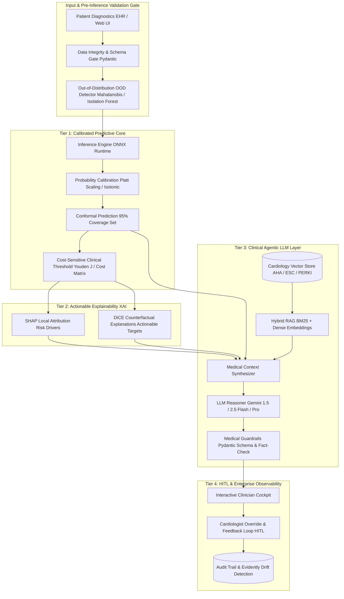

# 🫀 Future AI Architecture & Engineering Roadmap
## Clinical Decision Support System (CDSS) — Enterprise & Medical-Grade Blueprint

---

## 📌 Executive Summary

Sistem skrining dan stratifikasi risiko penyakit jantung saat ini telah memiliki fondasi rekayasa perangkat lunak dan *machine learning* yang solid:
- Pipeline atomik `sklearn.pipeline.Pipeline` bebas *data leakage*.
- Evaluasi validasi silang *5-Fold Stratified Cross-Validation* terlacak dengan **MLflow**.
- Interpretasi model lokal menggunakan **SHAP (TreeExplainer)**.
- Layanan konsultasi gaya hidup berbasis **Google Gemini API** dengan *graceful rule-based fallback*.
- Pengujian otomatis (14 unit test) dan kesiapan kontainerisasi Docker.

Dokumen ini menyajikan **cetak biru arsitektur lapisan AI masa depan** (*Future AI Architecture Roadmap*) yang dirancang untuk meningkatkan sistem ini dari sebuah *data science portfolio/prototype* menjadi **Clinical Decision Support System (CDSS) bertaraf dunia**, sejalan dengan prinsip *Software as a Medical Device (SaMD)*, *FDA AI/ML Action Plan*, serta standar penelitian klinis (*Stanford AIMI* / *Mayo Clinic Platform*).

---

## 🎯 Target State vs. Current State

| Dimensi | Keadaan Saat Ini (*Current State*) | Arsitektur Target (*World-Class Target State*) |
|---|---|---|
| **Estimasi Risiko** | Probabilitas baku Random Forest (*uncalibrated*) | **Calibrated Probability** (Platt/Isotonic) + **Conformal Prediction** (Jaminan statistik interval cakupan 95%) |
| **Ambang Batas Keputusan** | Threshold standar $0.5$ | **Cost-Sensitive Thresholding** (Youden's Index / $F_2$-score) memprioritaskan Sensitivitas $\ge 90\%$ untuk keamanan pasien |
| **Deteksi Anomali Input** | Validasi batas numerik Streamlit slider | **Out-of-Distribution (OOD) Gate** (Mahalanobis Distance / Isolation Forest) untuk menolak input non-fisiologis |
| **Interpretasi Klinis (XAI)** | Bar chart SHAP lokal (*post-hoc*) | **Actionable Counterfactuals (DiCE)** yang menghitung jalur intervensi minimal untuk menurunkan risiko |
| **Integrasi GenAI** | Pemanggilan prompt Gemini dengan 4 fitur mentah | **Clinical Agentic RAG** (AHA/ACC, ESC, PERKI) + **Pydantic Structured Outputs** + **Medical Guardrails** |
| **Arsitektur Sistem** | Monolitik Streamlit in-memory `.pkl` | **Decoupled Architecture**: Engine inferensi mandiri (FastAPI/gRPC + ONNX Runtime) terpisah dari UI |
| **Observabilitas & Drift** | Log lokal konsol & visualisasi statis | **Evidently AI** (Data & Concept Drift) + **Langfuse** (LLMOps tracing, token cost, & evaluasi halusinasi) |
| **Keadilan Algoritmik** | Belum diaudit per sub-populasi | **Fairness & Bias Auditing** (Fairlearn) untuk disparitas manifestasi gejala pria vs. wanita |

---

## 🏗️ 5-Tier Clinical AI Architecture



---

## 🔬 Spesifikasi Detail Lapisan AI

### Tier 1: Calibrated Predictive Core & Uncertainty Quantification

1. **Probability Calibration (`CalibratedClassifierCV`)**:
   - Random Forest dan neural network cenderung *overconfident* atau menghasilkan probabilitas yang terdistorsi di sekitar batas keputusan.
   - Menggunakan metode **Platt Scaling (Sigmoid)** atau **Isotonic Regression** melalui kalibrasi silang bebas kebocoran data untuk menjamin validitas nilai reliabilitas empiris (*Brier Score < 0.10*).

2. **Conformal Prediction (Uncertainty Guarantee)**:
   - Mengadopsi *Inductive Conformal Prediction (ICP)* dengan signifikansi $\alpha = 0.05$.
   - Hasil inferensi bukan sekadar label tunggal, melainkan *prediction set* dengan jaminan cakupan 95%:
     - $\{0\}$: Pasien diprediksi aman dengan kepastian tinggi.
     - $\{1\}$: Pasien diprediksi berisiko dengan kepastian tinggi.
     - $\{0, 1\}$: **Prediksi Ambigu (Zona Ketidakpastian Klinis)** $\rightarrow$ Sistem menandai kasus untuk eskalasi prioritas ke dokter spesialis (*Human-in-the-Loop*).

3. **Cost-Sensitive Optimal Operating Point**:
   - Dalam kardiologi skrining, konsekuensi klinis **False Negative (kematian akibat infark miokard)** berlipat ganda lebih fatal dibanding **False Positive (biaya skrining elektif lanjutan)**.
   - Threshold probabilitas tidak dipatok $0.5$, melainkan dihitung dinamis menggunakan kurva *Precision-Recall* dan indeks *Youden's J* yang memaksimalkan Recall (Sensitivity $\ge 90\%$).

4. **ONNX Runtime Engine**:
   - Model diekspor ke format terbuka Open Neural Network Exchange (`.onnx`).
   - Menyediakan waktu inferensi sub-milidetik, deterministik lintas platform, dan menghilangkan kerentanan keamanan deserialisasi `pickle`.

---

### Tier 2: Actionable Prescriptive XAI & Counterfactual Reasoning

1. **Counterfactual Explanations via DiCE (Diverse Counterfactual Explanations)**:
   - Menjawab pertanyaan klinis: *"Apa intervensi minimal yang realistis agar pasien berpindah dari kategori risiko tinggi ke risiko rendah?"*
   - Membagi fitur menjadi dua domain:
     - **Immutable Features** (tidak dapat diubah): `age`, `sex`.
     - **Actionable Features** (dapat diintervensi): `thalach` (lewat terapi latihan aerobik terpantau), `oldpeak` (lewat revaskularisasi/penanganan medis), `slope`.
   - Mengoptimalkan vektor jarak minimum $L_1$ untuk menghasilkan 2-3 skenario perbaikan yang realistis secara medis.

2. **Cohort Case-Based Reasoning ($k$-Nearest Neighbors)**:
   - Menghubungkan pasien saat ini dengan 3-5 rekam medis historis beranotasi yang paling menyerupai profil biomarker pasien.
   - Membantu dokter membandingkan hasil intervensi terdahulu pada kohort yang serupa (*precedent-based clinical validation*).

---

### Tier 3: Clinical Agentic GenAI Layer (Medical RAG & Safety Guardrails)

1. **Cardiovascular Hybrid RAG (Retrieval-Augmented Generation)**:
   - Basis pengetahuan terindeks:
     - *2023 AHA/ACC/ACCP/ASPC/NLA/PCNA Guideline for the Management of Patients With Chronic Coronary Disease*.
     - *2024 ESC Guidelines for the Management of Chronic Coronary Syndromes*.
     - *Pedoman Tata Laksana Sindrom Koroner Akut (PERKI)*.
   - Mesin pencari hibrida: kombinasi **Dense Vector Search** (vektor semantik) dan **Sparse Search (BM25)** untuk menjamin ketepatan istilah medis langka.

2. **Synthesis Berbasis Konteks Diagnostik Kaya**:
   Prompt LLM dirancang secara sistematis dengan menyuntikkan:
   - Nilai probabilitas terkalibrasi dan estimasi ketidakpastian conformal.
   - 3 kontributor risiko tertinggi dari SHAP.
   - Vektor target perubahan gaya hidup dari DiCE counterfactual.
   - Potongan pedoman klinis relevan dari Vector Store.

3. **Kontrak Data Terstruktur (Pydantic Schema Contract)**:
   Menjamin respon AI selalu valid, terurai, dan siap dikonsumsi API atau modul PDF/rekam medis elektronik:
   ```python
   from pydantic import BaseModel, Field
   from typing import List, Literal

   class LifestyleIntervention(BaseModel):
       domain: Literal["Aktivitas Fisik", "Nutrisi & Diet", "Manajemen Stres & Tidur"]
       recommendation: str
       target_metric: str
       guideline_reference: str

   class ClinicalAdvisoryOutput(BaseModel):
       risk_stratification: Literal["Rendah", "Sedang", "Tinggi", "Kritis"]
       calibrated_risk_score: float = Field(..., ge=0.0, le=1.0)
       primary_clinical_drivers: List[str]
       counterfactual_goals: List[str]
       personalized_interventions: List[LifestyleIntervention]
       diagnostic_escalations: List[str]
       contraindications_warning: List[str]
       disclaimer: str
   ```

4. **Safety & Malpractice Guardrails**:
   - Pengecekan kontraindikasi otomatis (misal: jika pasien memiliki iskemia aktif, AI dilarang menyarankan olahraga intensitas tinggi).
   - *Strict Policy Filter*: AI dilarang meresepkan nama obat keras atau dosis farmakologis tertentu (mencegah liabilitas hukum dan malpraktik).

---

### Tier 4: Enterprise MLOps, LLMOps & Decoupled Architecture

1. **Decoupled Microservice API (FastAPI / gRPC)**:
   - Memisahkan antarmuka pengguna (Streamlit / Mobile Web) dari mesin inferensi.
   - Endpoint terstandarisasi:
     - `POST /api/v1/predict`: Inferensi terkalibrasi + conformal bounds.
     - `POST /api/v1/explain`: Kalkulasi SHAP dan DiCE counterfactual.
     - `POST /api/v1/advise`: Medical RAG synthesis berbasis Gemini.
     - `GET /health/ready`: Liveness dan model artifact validation probe.

2. **Data & Concept Drift Monitoring (Evidently AI)**:
   - Melacak distribusi fitur masukan secara waktu nyata (*Kolmogorov-Smirnov Test* untuk fitur numerik, *Chi-Square Test* untuk kategori).
   - Memunculkan *alert* otomatis jika profil pasien bergeser signifikan dari populasi dataset pelatihan awal.

3. **LLMOps Observability (Langfuse / OpenInference)**:
   - Melacak latensi token, biaya API, dan versi prompt sistem.
   - Menghitung metrik evaluasi RAG (*Faithfulness*, *Answer Relevance*, dan *Context Precision*).

---

### Tier 5: Clinical Ethics, Fairness & Governance

1. **Fairness Auditing Lintas Demografi (Fairlearn)**:
   - Memastikan tidak ada disparitas akurasi atau sensitivitas antara pasien pria dan wanita (*Equal Opportunity Difference < 0.05*).
   - Mengingat gejala penyakit jantung pada wanita kerap bermanifestasi secara atipikal, model diaudit secara berkala untuk mencegah *under-diagnosis* sistemik.

2. **Human-in-the-Loop (HITL) Audit Trail**:
   - Klinisi memiliki kontrol penuh untuk menyetujui (*confirm*), menolak (*reject*), atau mengoreksi (*override*) hasil analisis sistem.
   - Setiap intervensi dicatat dalam log terenkripsi yang memenuhi regulasi perlindungan data medis (UU Perlindungan Data Pribadi / HIPAA).
   - Data koreksi klinisi dimanfaatkan sebagai bahan *Active Learning* untuk siklus pelatihan ulang model secara terkontrol.

---

## 🗺️ Roadmap Eksekusi Bertahap

```text
┌────────────────────────────────────────────────────────────────────────┐
│ Q1: Foundation & Uncertainty                                           │
│ • CalibratedClassifierCV (Platt / Isotonic)                            │
│ • Cost-sensitive threshold tuning (Youden Index)                       │
│ • Export model ke ONNX format                                          │
└───────────────────────────────────┬────────────────────────────────────┘
                                    │
                                    ▼
┌────────────────────────────────────────────────────────────────────────┐
│ Q2: Intelligent RAG & Structured LLM                                   │
│ • Refactor llm_advisor ke Google GenAI SDK modern                      │
│ • Enforce Pydantic schema validation pada output AI                    │
│ • Injeksi SHAP local driver ke dalam prompt context                    │
│ • Setup Vector Store pedoman kardiologi (AHA/ACC & PERKI)              │
└───────────────────────────────────┬────────────────────────────────────┘
                                    │
                                    ▼
┌────────────────────────────────────────────────────────────────────────┐
│ Q3: Prescriptive Explainability                                        │
│ • Integrasi DiCE Counterfactual Explanations                           │
│ • Visualisasi target intervensi yang dapat diubah pasien               │
│ • Audit fairness demografi gender via Fairlearn                        │
└───────────────────────────────────┬────────────────────────────────────┘
                                    │
                                    ▼
┌────────────────────────────────────────────────────────────────────────┐
│ Q4: Enterprise Production Serving                                      │
│ • Decoupling inferensi ke FastAPI microservice                         │
│ • Integrasi Evidently AI untuk deteksi data drift                      │
│ • Integrasi Langfuse untuk tracing & evaluasi LLMOps                   │
│ • Modul dokter Human-in-the-Loop (HITL) feedback logging               │
└────────────────────────────────────────────────────────────────────────┘
```

---

## 💻 Contoh Implementasi Komponen Utama

### 1. Calibrated Classifier & Optimal Threshold
```python
from sklearn.calibration import CalibratedClassifierCV
from sklearn.metrics import roc_curve
import numpy as np

def build_calibrated_model(base_pipeline, X_train, y_train):
    """
    Melatih model dengan kalibrasi probabilitas menggunakan CalibratedClassifierCV (Sigmoid / Platt Scaling).
    """
    calibrated_pipe = CalibratedClassifierCV(
        estimator=base_pipeline,
        method='sigmoid',
        cv=5
    )
    calibrated_pipe.fit(X_train, y_train)
    return calibrated_pipe

def find_optimal_clinical_threshold(y_true, y_prob):
    """
    Menghitung threshold optimal menggunakan Youden's J statistic (Sensitivity + Specificity - 1).
    """
    fpr, tpr, thresholds = roc_curve(y_true, y_prob)
    j_scores = tpr - fpr
    optimal_idx = np.argmax(j_scores)
    return thresholds[optimal_idx], tpr[optimal_idx], 1 - fpr[optimal_idx]
```

### 2. DiCE Actionable Counterfactual Generation
```python
import dice_ml

def generate_patient_counterfactuals(trained_model, df_train, patient_input_df):
    """
    Menghasilkan jalur intervensi minimal dengan membatasi fitur hanya pada parameter actionable.
    """
    d = dice_ml.Data(
        dataframe=df_train,
        continuous_features=['age', 'thalach', 'oldpeak'],
        outcome_name='target'
    )
    m = dice_ml.Model(model=trained_model, backend="sklearn")
    exp = dice_ml.Dice(d, m, method="random")

    # Batasi agar usia dan jenis kelamin tidak dapat diubah (immutable)
    cf = exp.generate_counterfactuals(
        patient_input_df,
        total_CFs=3,
        desired_class=0,
        features_to_vary=['thalach', 'oldpeak', 'slope']
    )
    return cf
```

---

## 📄 Kesimpulan

Dengan mengimplementasikan cetak biru arsitektur 5-Tier di atas:
1. **Model** beralih dari sekadar angka tebakan menjadi estimasi risiko terkalibrasi dengan jaminan ketidakpastian matematis.
2. **Explainability** beralih dari sekadar grafik analitis menjadi saran perbaikan gaya hidup preskriptif dan dapat dicapai (*counterfactual*).
3. **GenAI** terlindungi dari risiko halusinasi medis berkat *Medical RAG*, *Pydantic Schema*, dan *Guardrails*.
4. **Sistem Keseluruhan** siap bertransformasi menjadi platform klinis berskala industri (*enterprise CDSS*) yang transparan, andal, dan aman.
